# Modelo de Dados — GymManager

**Sistema web de gerenciamento de treinos de academia**
Disciplina: Gerência de Configuração (6º período) · CENTRO UNIVERSITÁRIO FAMETRO
Professor: Paulo Rodrigo Barbosa Alves

| Campo | Valor |
| --- | --- |
| ID do IC | GYM-ARQ-002 |
| Caminho | `documentos/arquitetura/Modelo_de_Dados.md` |
| Versão | 0.1.0 |
| Status | Em elaboração |
| Baseline prevista | BL-IMPL-S2 |
| Responsável | João Vitor Simonetti (DBA/DevOps) |
| Apoio | Dev Backend e Frontend |
| Dependência | GYM-REQ-001 (ERS), GYM-ARQ-001 (Arquitetura) |
| ICs relacionados | GYM-DB-001 (Migrações), GYM-SRC-001 a 005 |

## Histórico de revisões

| Versão | Data | Autor | Descrição | CR/Issue |
| --- | --- | --- | --- | --- |
| 0.1.0 | 10/11/2026 | João Vitor Simonetti | Versão inicial: modelo físico, dicionário de dados e migração V001 | — |

---

## 1. Introdução

Este documento detalha o modelo conceitual da seção 4.2 do ERS (GYM-REQ-001) até o nível físico implementado no MySQL 8.4. O esquema é criado **exclusivamente** pelas migrações versionadas em `banco-de-dados/migracoes/` (GYM-DB-001), conforme RNF11.

**Convenções**

- Nomes de tabelas e colunas em português, minúsculas, `snake_case`, no singular.
- Chave primária `id` (`INT UNSIGNED AUTO_INCREMENT`); chaves estrangeiras `<entidade>_id`.
- Restrições nomeadas: `pk_`, `fk_`, `uq_`, `ck_`; índices `ix_`.
- Conjunto de caracteres `utf8mb4` com colação `utf8mb4_0900_ai_ci` (comparação sem diferenciar maiúsculas/acentos, o que faz "Supino" e "supino" serem o mesmo nome de exercício).
- Datas e horas gravadas em UTC.
- Registros nunca são excluídos fisicamente pela aplicação: usa-se a coluna `ativo`/`ativa` (RN04, RN05). A única exceção é a tabela técnica `sessao`.

---

## 2. Diagrama entidade-relacionamento

```mermaid
erDiagram
    USUARIO ||--o{ SESSAO : "possui"
    USUARIO ||--o{ FICHA : "é aluno de (aluno_id)"
    USUARIO ||--o{ FICHA : "criou (instrutor_id)"
    FICHA ||--|{ FICHA_EXERCICIO : "contém"
    EXERCICIO ||--o{ FICHA_EXERCICIO : "compõe"
    FICHA ||--o{ EXECUCAO : "gera"
    USUARIO ||--o{ EXECUCAO : "realiza (aluno_id)"
    EXECUCAO ||--o{ EXECUCAO_EXERCICIO : "registra"
    FICHA_EXERCICIO ||--o{ EXECUCAO_EXERCICIO : "referencia"

    USUARIO {
        int id PK
        varchar nome
        varchar email UK
        varchar senha_hash
        enum perfil
        bool ativo
        date data_nascimento
        varchar telefone
    }
    SESSAO {
        int id PK
        int usuario_id FK
        char token_hash UK
        datetime expira_em
    }
    EXERCICIO {
        int id PK
        varchar nome UK
        varchar grupo_muscular
        text descricao
        bool ativo
    }
    FICHA {
        int id PK
        varchar nome
        int aluno_id FK
        int instrutor_id FK
        date data_inicio
        date data_fim
        bool ativa
    }
    FICHA_EXERCICIO {
        int id PK
        int ficha_id FK
        int exercicio_id FK
        smallint series
        smallint repeticoes
        decimal carga_kg
        smallint descanso_s
        smallint ordem
        bool ativo
    }
    EXECUCAO {
        int id PK
        int ficha_id FK
        int aluno_id FK
        datetime inicio
        datetime fim
    }
    EXECUCAO_EXERCICIO {
        int id PK
        int execucao_id FK
        int ficha_exercicio_id FK
        smallint repeticoes
        decimal carga_kg
    }
```

**Diferenças em relação ao modelo conceitual do ERS** (detalhamento técnico, sem alterar requisitos):

| Item | Motivo |
| --- | --- |
| Tabela `sessao` | Necessária para autenticação com logout e revogação (RF02, RN05). Ver ADR-001 |
| Coluna `ficha_exercicio.ativo` | Permite remover um exercício de uma ficha já executada sem apagar o histórico (RN05: histórico preservado) |
| Colunas `criado_em` / `atualizado_em` | Auditoria básica das alterações |

---

## 3. Dicionário de dados

### 3.1 `usuario`

Administradores, instrutores e alunos. Os dados específicos do aluno (nascimento, telefone) são opcionais e só usados no perfil ALUNO.

| Coluna | Tipo | Nulo | Padrão | Descrição / regra |
| --- | --- | --- | --- | --- |
| id | INT UNSIGNED | não | auto | Identificador |
| nome | VARCHAR(100) | não | — | 2 a 100 caracteres (ERS 4.3) |
| email | VARCHAR(254) | não | — | Único; formato válido; gravado em minúsculas |
| senha_hash | VARCHAR(255) | não | — | Hash scrypt com sal; nunca a senha em texto (RNF01) |
| perfil | ENUM('ADMIN','INSTRUTOR','ALUNO') | não | — | Perfil de acesso (RF02) |
| ativo | TINYINT(1) | não | 1 | 0 = inativo: não autentica e não recebe fichas (RN05) |
| data_nascimento | DATE | sim | — | Somente aluno |
| telefone | VARCHAR(20) | sim | — | Somente aluno |
| criado_em | DATETIME | não | agora | Data de criação |
| atualizado_em | DATETIME | não | agora | Atualizada automaticamente |

Restrições: `pk_usuario (id)`, `uq_usuario_email (email)`, índice `ix_usuario_perfil_ativo (perfil, ativo)`.

### 3.2 `sessao`

| Coluna | Tipo | Nulo | Padrão | Descrição / regra |
| --- | --- | --- | --- | --- |
| id | INT UNSIGNED | não | auto | Identificador |
| usuario_id | INT UNSIGNED | não | — | FK `usuario.id` (`ON DELETE CASCADE`) |
| token_hash | CHAR(64) | não | — | SHA-256 do token entregue no login; o token em si não é armazenado |
| criado_em | DATETIME | não | agora | Início da sessão |
| expira_em | DATETIME | não | — | Fim da validade (`SESSAO_HORAS`) |

Restrições: `uq_sessao_token (token_hash)`, índice `ix_sessao_expira (expira_em)`.

### 3.3 `exercicio`

| Coluna | Tipo | Nulo | Padrão | Descrição / regra |
| --- | --- | --- | --- | --- |
| id | INT UNSIGNED | não | auto | Identificador |
| nome | VARCHAR(100) | não | — | Obrigatório e único: "Exercício já cadastrado." (ERS 4.3) |
| grupo_muscular | VARCHAR(50) | sim | — | Ex.: Peito, Costas, Pernas, Ombros, Braços |
| descricao | TEXT | sim | — | Orientações de execução |
| ativo | TINYINT(1) | não | 1 | Inativo não entra em fichas novas, mas permanece nas existentes (RN04) |
| criado_em / atualizado_em | DATETIME | não | agora | Auditoria |

Restrições: `uq_exercicio_nome (nome)`, índice `ix_exercicio_grupo (grupo_muscular)`. As FKs de `ficha_exercicio` impedem a exclusão física de exercício em uso (RN04).

### 3.4 `ficha`

| Coluna | Tipo | Nulo | Padrão | Descrição / regra |
| --- | --- | --- | --- | --- |
| id | INT UNSIGNED | não | auto | Identificador |
| nome | VARCHAR(100) | não | — | Ex.: "Hipertrofia – Treino A" |
| aluno_id | INT UNSIGNED | não | — | FK `usuario.id`; um único aluno por ficha (RN06) |
| instrutor_id | INT UNSIGNED | não | — | FK `usuario.id`; instrutor ou admin que criou (RN01) |
| data_inicio | DATE | não | — | Início da vigência |
| data_fim | DATE | sim | — | `>= data_inicio` (`ck_ficha_datas`) — "Data final anterior à inicial." |
| ativa | TINYINT(1) | não | 1 | 0 = ficha encerrada |
| criado_em / atualizado_em | DATETIME | não | agora | Auditoria |

Uma ficha é **vigente** quando `ativa = 1` e (`data_fim` é nula ou `data_fim >= hoje`). Somente fichas vigentes aceitam novas execuções.

### 3.5 `ficha_exercicio`

| Coluna | Tipo | Nulo | Padrão | Descrição / regra |
| --- | --- | --- | --- | --- |
| id | INT UNSIGNED | não | auto | Identificador |
| ficha_id | INT UNSIGNED | não | — | FK `ficha.id` |
| exercicio_id | INT UNSIGNED | não | — | FK `exercicio.id` |
| series | SMALLINT UNSIGNED | não | — | `> 0` |
| repeticoes | SMALLINT UNSIGNED | não | — | `> 0` |
| carga_kg | DECIMAL(6,2) | não | 0.00 | `>= 0`, até 2 casas decimais |
| descanso_s | SMALLINT UNSIGNED | não | 0 | `>= 0` |
| ordem | SMALLINT UNSIGNED | não | 1 | Ordem de execução na ficha |
| ativo | TINYINT(1) | não | 1 | 0 = item removido da ficha (histórico preservado) |

Regra RN06 (pelo menos um exercício por ficha) é garantida pela aplicação, que exige ao menos um item ativo ao salvar.

### 3.6 `execucao`

| Coluna | Tipo | Nulo | Padrão | Descrição / regra |
| --- | --- | --- | --- | --- |
| id | INT UNSIGNED | não | auto | Identificador |
| ficha_id | INT UNSIGNED | não | — | FK `ficha.id`; deve ser ficha do próprio aluno (RN07) |
| aluno_id | INT UNSIGNED | não | — | FK `usuario.id` |
| inicio | DATETIME | não | — | Data/hora de início (UTC) |
| fim | DATETIME | sim | — | Nula enquanto em andamento; `>= inicio` |

Índice `ix_execucao_aluno_inicio (aluno_id, inicio)` atende à consulta de histórico (UC08, RNF04).

### 3.7 `execucao_exercicio`

| Coluna | Tipo | Nulo | Padrão | Descrição / regra |
| --- | --- | --- | --- | --- |
| id | INT UNSIGNED | não | auto | Identificador |
| execucao_id | INT UNSIGNED | não | — | FK `execucao.id` |
| ficha_exercicio_id | INT UNSIGNED | não | — | FK `ficha_exercicio.id` |
| repeticoes | SMALLINT UNSIGNED | não | — | Repetições realizadas, `> 0` |
| carga_kg | DECIMAL(6,2) | não | 0.00 | Carga realizada, `>= 0` |
| registrado_em | DATETIME | não | agora | Momento do registro |

Restrição `uq_ee_execucao_item (execucao_id, ficha_exercicio_id)`: um registro por exercício em cada execução; registrar de novo o mesmo exercício **corrige** o registro (UC07, FA1).

### 3.8 `schema_migracoes` (controle)

Criada automaticamente pelo executor de migrações; não faz parte do domínio.

| Coluna | Tipo | Descrição |
| --- | --- | --- |
| versao | VARCHAR(20) PK | Ex.: `V001` |
| descricao | VARCHAR(200) | Ex.: `cria_tabelas` |
| checksum | CHAR(64) | SHA-256 do arquivo aplicado |
| aplicada_em | DATETIME | Data/hora da aplicação |

---

## 4. Regras de negócio no modelo

| Regra | Implementação |
| --- | --- |
| RN01 | `ficha.instrutor_id` preenchido com o usuário logado; rota de criação restrita a ADMIN/INSTRUTOR |
| RN02 | Consultas de fichas, execuções e histórico filtradas por `aluno_id` do usuário logado |
| RN04 | Sem exclusão física; FKs `fk_fe_exercicio` bloqueiam remoção de exercício em uso |
| RN05 | Colunas `usuario.ativo`; sessões removidas ao inativar; histórico mantido |
| RN06 | `ficha.aluno_id NOT NULL`; ao menos um `ficha_exercicio` ativo (validação na aplicação) |
| RN07 | `execucao.aluno_id` deve ser igual a `ficha.aluno_id` (validação na aplicação) |

---

## 5. Migrações (GYM-DB-001)

| Arquivo | Descrição |
| --- | --- |
| `V001__cria_tabelas.sql` | Cria `usuario`, `sessao`, `exercicio`, `ficha`, `ficha_exercicio`, `execucao`, `execucao_exercicio` |

Procedimento:

1. Nova mudança de esquema = novo arquivo `V<NNN+1>__<descricao>.sql`, registrado neste documento (seção 5) e no histórico de revisões.
2. Nunca editar migração já aplicada: o executor compara o checksum e interrompe a execução se houver divergência.
3. Aplicar com `flask --app wsgi migrar` (feito automaticamente ao subir o contêiner do backend e no CI).

## 6. Controle de configuração deste documento

Este documento é o IC **GYM-ARQ-002**, sujeito ao Plano de GC (GYM-GER-003). Toda alteração de esquema atualiza, no mesmo PR, este documento, a migração correspondente (GYM-DB-001) e os modelos do backend (GYM-SRC-001 a 005).
