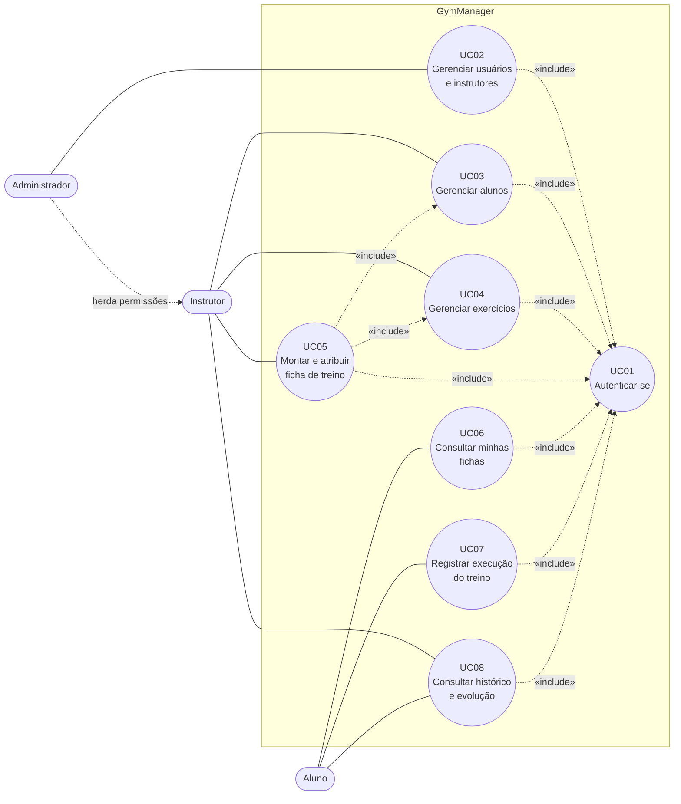

# Casos de Uso — GymManager

**Sistema web de gerenciamento de treinos de academia**
Disciplina: Gerência de Configuração (6º período) · CENTRO UNIVERSITÁRIO FAMETRO
Professor: Paulo Rodrigo Barbosa Alves

| Campo | Valor |
| --- | --- |
| ID do IC | GYM-REQ-002 |
| Caminho | `documentos/requisitos/Casos_de_Uso.md` |
| Versão | 0.1.0 |
| Status | Em elaboração |
| Baseline prevista | BL-REQ-S1 (Funcional) |
| Responsável | Renata Martins da Silva (Analista de Requisitos) |
| Apoio | João Vitor Simonetti (Dev Backend e Frontend) |
| Dependência | GYM-REQ-001 (ERS) |
| ICs relacionados | GYM-REQ-003 (RTM), GYM-REQ-004 (Protótipos de tela), GYM-ARQ-003 (OpenAPI) |

## Histórico de revisões

| Versão | Data | Autor | Descrição | CR/Issue |
| --- | --- | --- | --- | --- |
| 0.1.0 | 2026-11-09 | Renata Martins da Silva | Versão inicial do documento | — |

---

## 1. Introdução

### 1.1 Propósito

Este documento apresenta a modelagem de casos de uso do **GymManager**, detalhando como cada ator interage com o sistema para cumprir os requisitos do ERS (GYM-REQ-001). Ele serve de base para a especificação da API (GYM-ARQ-003), a interface web (GYM-SRC-006), o Plano de Testes (GYM-TST-001) e o Manual do Usuário (GYM-DOC-002).

### 1.2 Convenções

- **Identificadores:** casos de uso `UC01` a `UC08`; requisitos `RF`, `RNF` e regras de negócio `RN`, todos conforme o ERS; telas `TL01` a `TL09`, conforme os protótipos (GYM-REQ-004).
- **Fluxo principal:** sequência normal de passos, sem falhas.
- **Fluxos alternativos (FA):** variações válidas do fluxo principal.
- **Fluxos de exceção (FE):** situações de erro, com a resposta do sistema.
- Mensagens de erro de validação seguem a seção 4.3 do ERS.

---

## 2. Atores

| Ator | Descrição | Observação |
| --- | --- | --- |
| Administrador | Responsável pela gestão do sistema: usuários, instrutores e perfis | Herda todas as permissões do Instrutor |
| Instrutor | Profissional da academia que gerencia alunos, exercícios e fichas e acompanha a evolução | — |
| Aluno | Praticante atendido pela academia; consulta fichas, registra execuções e vê seu histórico | Acessa apenas os próprios dados (RN02) |

---

## 3. Diagrama de casos de uso

**Leitura do diagrama:**

- Todos os casos de uso, exceto UC01, exigem autenticação (RNF02); por isso incluem UC01.
- O Administrador herda do Instrutor e, por isso, também realiza UC03, UC04, UC05 e UC08, além de UC02.
- UC05 depende de alunos e exercícios já cadastrados (UC03 e UC04), representados como inclusões.
- UC01 é realizado por todos os atores.

---

## 4. Lista de casos de uso

| ID | Caso de uso | Ator(es) | Requisito(s) | Regras de negócio | Telas |
| --- | --- | --- | --- | --- | --- |
| UC01 | Autenticar-se | Todos | RF02, RF07 | RN05 | TL01, TL02 |
| UC02 | Gerenciar usuários e instrutores | Administrador | RF06 | RN03, RN05 | TL03 |
| UC03 | Gerenciar alunos | Administrador, Instrutor | RF01 | RN05 | TL04 |
| UC04 | Gerenciar exercícios | Administrador, Instrutor | RF03 | RN04 | TL05 |
| UC05 | Montar e atribuir ficha de treino | Instrutor, Administrador | RF04 | RN01, RN04, RN05, RN06 | TL06 |
| UC06 | Consultar minhas fichas | Aluno | RF04, RF07 | RN02 | TL07 |
| UC07 | Registrar execução do treino | Aluno | RF05 | RN02, RN07 | TL08 |
| UC08 | Consultar histórico e evolução de carga | Aluno, Instrutor, Administrador | RF05 | RN02 | TL09 |

---

## 5. Descrição dos casos de uso

### UC01 — Autenticar-se

| Item | Descrição |
| --- | --- |
| Ator | Administrador, Instrutor, Aluno |
| Requisitos | RF02, RF07 |
| Regras de negócio | RN05 |
| Tela | TL01 (Login), TL02 (Painel inicial) |
| Endpoints | `POST /auth/login`, `POST /auth/logout` |
| Pré-condição | Usuário cadastrado e ativo |
| Pós-condição | Sessão iniciada e menu exibido conforme o perfil; ou sessão encerrada (logout) |

**Fluxo principal**

1. O usuário acessa a tela de login (TL01).
2. Informa e-mail e senha.
3. O sistema valida o formato dos dados e confere as credenciais.
4. O sistema inicia a sessão e identifica o perfil do usuário.
5. O sistema exibe o painel inicial (TL02) com as funções permitidas ao perfil.

**Fluxos alternativos**

- **FA1 — Encerrar sessão:** no passo 5 em diante, o usuário aciona "Sair"; o sistema encerra a sessão e retorna à TL01.

**Fluxos de exceção**

- **FE1 — Credenciais inválidas:** o sistema informa o erro sem indicar qual campo está incorreto e permanece na TL01.
- **FE2 — Usuário inativo:** o sistema nega o acesso e informa que o usuário está inativo (RN05).
- **FE3 — Dados inválidos:** e-mail em formato inválido ou campo vazio; o sistema exibe a mensagem de validação.

---

### UC02 — Gerenciar usuários e instrutores

| Item | Descrição |
| --- | --- |
| Ator | Administrador |
| Requisitos | RF06 |
| Regras de negócio | RN03, RN05 |
| Tela | TL03 (Usuários e instrutores) |
| Endpoints | `GET /usuarios`, `POST /usuarios`, `PUT /usuarios/{id}`, `DELETE /usuarios/{id}` |
| Pré-condição | Administrador autenticado (UC01) |
| Pós-condição | Cadastro de usuário criado, atualizado ou inativado |

**Fluxo principal (cadastrar usuário ou instrutor)**

1. O administrador acessa a TL03 e seleciona "Novo usuário".
2. Informa nome, e-mail, senha inicial e perfil (administrador, instrutor ou aluno).
3. O sistema valida os dados (e-mail único, senha com 8 caracteres ou mais, perfil válido).
4. O sistema grava a senha com hash e registra o usuário como ativo.
5. O sistema exibe o usuário na listagem e confirma o cadastro.

**Fluxos alternativos**

- **FA1 — Consultar:** o administrador visualiza a listagem e filtra por nome, e-mail ou perfil.
- **FA2 — Editar:** o administrador seleciona um usuário, altera nome, e-mail ou perfil, e salva.
- **FA3 — Inativar:** o administrador seleciona "Inativar" e confirma; o usuário passa a inativo e perde o acesso, e o histórico é preservado (RN05).

**Fluxos de exceção**

- **FE1 — E-mail já cadastrado:** o sistema exibe "E-mail inválido ou já cadastrado."
- **FE2 — Senha fraca:** o sistema exibe "Senha fraca."
- **FE3 — Sem permissão:** usuário que não seja administrador tenta acessar; o sistema retorna erro 403 (RN03).

---

### UC03 — Gerenciar alunos

| Item | Descrição |
| --- | --- |
| Ator | Administrador, Instrutor |
| Requisitos | RF01 |
| Regras de negócio | RN05 |
| Tela | TL04 (Alunos) |
| Endpoints | `GET /alunos`, `POST /alunos`, `GET /alunos/{id}`, `PUT /alunos/{id}`, `DELETE /alunos/{id}` |
| Pré-condição | Usuário autenticado (UC01) com perfil de instrutor ou administrador |
| Pós-condição | Aluno cadastrado, atualizado ou inativado |

**Fluxo principal (cadastrar aluno)**

1. O ator acessa a TL04 e seleciona "Novo aluno".
2. Informa nome, e-mail, senha inicial e demais dados do aluno (data de nascimento e telefone).
3. O sistema valida os dados.
4. O sistema registra o aluno com perfil ALUNO e situação ativa.
5. O sistema exibe o aluno na listagem e confirma o cadastro.

**Fluxos alternativos**

- **FA1 — Consultar:** o ator pesquisa e visualiza os dados de um aluno.
- **FA2 — Editar:** o ator altera os dados do aluno e salva.
- **FA3 — Inativar:** o ator inativa o aluno após confirmação; o aluno não se autentica nem recebe novas fichas, e o histórico é mantido (RN05).

**Fluxos de exceção**

- **FE1 — E-mail já cadastrado ou dados inválidos:** o sistema exibe a mensagem de validação correspondente.
- **FE2 — Aluno não encontrado:** o sistema retorna erro 404.

---

### UC04 — Gerenciar exercícios

| Item | Descrição |
| --- | --- |
| Ator | Administrador, Instrutor |
| Requisitos | RF03 |
| Regras de negócio | RN04 |
| Tela | TL05 (Catálogo de exercícios) |
| Endpoints | `GET /exercicios`, `POST /exercicios`, `PUT /exercicios/{id}`, `DELETE /exercicios/{id}` |
| Pré-condição | Usuário autenticado (UC01) com perfil de instrutor ou administrador |
| Pós-condição | Exercício cadastrado, atualizado ou inativado no catálogo |

**Fluxo principal (cadastrar exercício)**

1. O ator acessa a TL05 e seleciona "Novo exercício".
2. Informa nome, grupo muscular e descrição.
3. O sistema valida os dados (nome obrigatório e único).
4. O sistema registra o exercício como ativo.
5. O sistema exibe o exercício no catálogo.

**Fluxos alternativos**

- **FA1 — Consultar:** o ator lista e filtra os exercícios por nome ou grupo muscular.
- **FA2 — Editar:** o ator altera os dados e salva.
- **FA3 — Inativar:** o ator inativa o exercício; ele deixa de ser oferecido para novas fichas, mas permanece nas fichas existentes (RN04).

**Fluxos de exceção**

- **FE1 — Nome duplicado:** o sistema exibe "Exercício já cadastrado."
- **FE2 — Tentativa de exclusão de exercício em uso:** o sistema não exclui e propõe a inativação (RN04).

---

### UC05 — Montar e atribuir ficha de treino

| Item | Descrição |
| --- | --- |
| Ator | Instrutor (e Administrador) |
| Requisitos | RF04 |
| Regras de negócio | RN01, RN04, RN05, RN06 |
| Tela | TL06 (Montagem de ficha de treino) |
| Endpoints | `GET /fichas`, `POST /fichas`, `GET /fichas/{id}`, `PUT /fichas/{id}` |
| Pré-condição | Instrutor autenticado (UC01); aluno ativo (UC03) e exercícios ativos (UC04) cadastrados |
| Pós-condição | Ficha ativa, atribuída ao aluno e visível a ele |

**Fluxo principal**

1. O instrutor acessa a TL06 e seleciona o aluno.
2. Cria a ficha informando nome, data de início e, opcionalmente, data de fim.
3. Adiciona exercícios do catálogo, informando para cada um séries, repetições, carga (kg), descanso (s) e ordem.
4. Salva a ficha.
5. O sistema valida os dados e confere que há ao menos um exercício (RN06).
6. O sistema grava a ficha, atribui ao aluno e confirma a operação.

**Fluxos alternativos**

- **FA1 — Editar ficha:** o instrutor abre uma ficha existente, altera exercícios ou parâmetros e salva.
- **FA2 — Consultar fichas:** o instrutor lista as fichas, filtrando por aluno.
- **FA3 — Encerrar ficha:** o instrutor informa a data de fim ou marca a ficha como inativa; ela deixa de aparecer como ativa para o aluno, e o histórico é mantido.

**Fluxos de exceção**

- **FE1 — Ficha sem exercício:** o sistema impede o salvamento (RN06).
- **FE2 — Valores inválidos:** séries ou repetições menores ou iguais a zero, carga negativa ou data de fim anterior à de início; o sistema mantém a ficha em edição e exibe a mensagem de validação.
- **FE3 — Aluno inativo:** o sistema não permite atribuir a ficha (RN05).
- **FE4 — Usuário sem permissão:** perfil aluno tenta criar ou alterar ficha; o sistema retorna erro 403 (RN01).

---

### UC06 — Consultar minhas fichas

| Item | Descrição |
| --- | --- |
| Ator | Aluno |
| Requisitos | RF04, RF07 |
| Regras de negócio | RN02 |
| Tela | TL07 (Minhas fichas) |
| Endpoints | `GET /fichas`, `GET /fichas/{id}` |
| Pré-condição | Aluno autenticado (UC01) |
| Pós-condição | Fichas do aluno exibidas |

**Fluxo principal**

1. O aluno acessa a TL07.
2. O sistema lista as fichas ativas atribuídas ao aluno logado.
3. O aluno seleciona uma ficha.
4. O sistema exibe os exercícios, com séries, repetições, carga e descanso, na ordem definida.

**Fluxos alternativos**

- **FA1 — Sem ficha ativa:** o sistema informa que não há fichas atribuídas e orienta procurar o instrutor.
- **FA2 — Iniciar treino:** a partir da ficha exibida, o aluno aciona "Iniciar treino" e segue para o UC07.

**Fluxos de exceção**

- **FE1 — Ficha de outro aluno:** o aluno tenta acessar ficha que não lhe pertence; o sistema retorna erro 403 ou 404 (RN02).

---

### UC07 — Registrar execução do treino

| Item | Descrição |
| --- | --- |
| Ator | Aluno |
| Requisitos | RF05 |
| Regras de negócio | RN02, RN07 |
| Tela | TL08 (Registro de execução) |
| Endpoints | `POST /execucoes`, `POST /execucoes/{id}/exercicios`, `PATCH /execucoes/{id}/finalizar` |
| Pré-condição | Aluno autenticado (UC01) com ficha ativa atribuída (UC05) |
| Pós-condição | Execução registrada e disponível no histórico (UC08) |

**Fluxo principal**

1. O aluno seleciona a ficha do dia e aciona "Iniciar treino" (a partir do UC06).
2. O sistema cria a execução, registra a data e a hora de início e exibe os exercícios da ficha.
3. Para cada exercício, o aluno informa as repetições realizadas e a carga utilizada (kg).
4. O sistema grava cada registro, vinculado ao item correspondente da ficha.
5. Ao concluir, o aluno aciona "Finalizar treino".
6. O sistema registra a data e a hora de término e confirma a execução.

**Fluxos alternativos**

- **FA1 — Corrigir registro:** antes de finalizar, o aluno altera a repetição ou a carga de um exercício já registrado.
- **FA2 — Finalizar parcialmente:** o aluno finaliza sem ter registrado todos os exercícios; o sistema grava apenas os informados.

**Fluxos de exceção**

- **FE1 — Valores inválidos:** repetições ou carga negativas; o sistema exibe "Carga inválida." ou "Valor deve ser maior que zero." e não grava o registro.
- **FE2 — Ficha não atribuída ao aluno:** o sistema retorna erro 403 (RN02, RN07).
- **FE3 — Execução já finalizada:** o sistema impede novos registros na execução encerrada.

---

### UC08 — Consultar histórico e evolução de carga

| Item | Descrição |
| --- | --- |
| Ator | Aluno (próprio histórico); Instrutor e Administrador (histórico dos alunos) |
| Requisitos | RF05 |
| Regras de negócio | RN02 |
| Tela | TL09 (Histórico e evolução de carga) |
| Endpoints | `GET /alunos/{id}/historico` |
| Pré-condição | Usuário autenticado (UC01); existem execuções registradas (UC07) |
| Pós-condição | Histórico e evolução exibidos |

**Fluxo principal**

1. O ator acessa a TL09 (o aluno vê o próprio histórico; o instrutor seleciona um aluno).
2. O sistema lista as execuções realizadas, da mais recente para a mais antiga, com data, ficha e duração.
3. O ator seleciona um exercício.
4. O sistema exibe a evolução da carga e das repetições desse exercício ao longo do tempo.

**Fluxos alternativos**

- **FA1 — Filtrar por período ou ficha:** o ator restringe o histórico a um intervalo de datas ou a uma ficha.
- **FA2 — Detalhar execução:** o ator abre uma execução e vê o registro de cada exercício.

**Fluxos de exceção**

- **FE1 — Sem execuções:** o sistema informa que ainda não há treinos registrados.
- **FE2 — Histórico de outro aluno:** o aluno tenta consultar o histórico de terceiros; o sistema retorna erro 403 (RN02).

---

## 6. Rastreabilidade dos casos de uso

| Caso de uso | Requisito(s) | IC de código | IC de teste | Tela(s) |
| --- | --- | --- | --- | --- |
| UC01 | RF02, RF07 | GYM-SRC-001, GYM-SRC-006 | GYM-TST-001 a GYM-TST-004 | TL01, TL02 |
| UC02 | RF06 | GYM-SRC-001, GYM-SRC-006 | GYM-TST-001 a GYM-TST-004 | TL03 |
| UC03 | RF01 | GYM-SRC-002, GYM-SRC-006 | GYM-TST-001 a GYM-TST-004 | TL04 |
| UC04 | RF03 | GYM-SRC-003, GYM-SRC-006 | GYM-TST-001 a GYM-TST-004 | TL05 |
| UC05 | RF04 | GYM-SRC-004, GYM-SRC-006 | GYM-TST-001 a GYM-TST-004 | TL06 |
| UC06 | RF04, RF07 | GYM-SRC-004, GYM-SRC-006 | GYM-TST-001 a GYM-TST-004 | TL07 |
| UC07 | RF05 | GYM-SRC-005, GYM-SRC-006 | GYM-TST-001 a GYM-TST-004 | TL08 |
| UC08 | RF05 | GYM-SRC-005, GYM-SRC-006 | GYM-TST-001 a GYM-TST-004 | TL09 |

A matriz completa, com todos os requisitos funcionais e não funcionais, está em `documentos/requisitos/RTM.xlsx` (GYM-REQ-003).

---

## 7. Controle de configuração deste documento

- Este documento é o IC **GYM-REQ-002** e está sujeito às regras do Plano de GC (GYM-GER-003).
- Até a baseline BL-REQ-S1, alterações seguem por issue e Pull Request, revisadas por outro integrante; após a baseline, somente mediante CR aprovada pelo CCB.
- Qualquer mudança de caso de uso deve manter coerência com o ERS (GYM-REQ-001), a RTM (GYM-REQ-003), os protótipos (GYM-REQ-004), a especificação OpenAPI (GYM-ARQ-003) e o Plano de Testes (GYM-TST-001).
- Cada revisão incrementa a versão (SemVer) no início do documento, no histórico de revisões e na planilha de ICs (GYM-GER-002).
- Antes da baseline, o documento passa por revisão técnica formal do QA/Testes (Iago Medice Ferreira da Silva, Tiago Costa dos Santos e Ruan Victor Assunção Costa).
