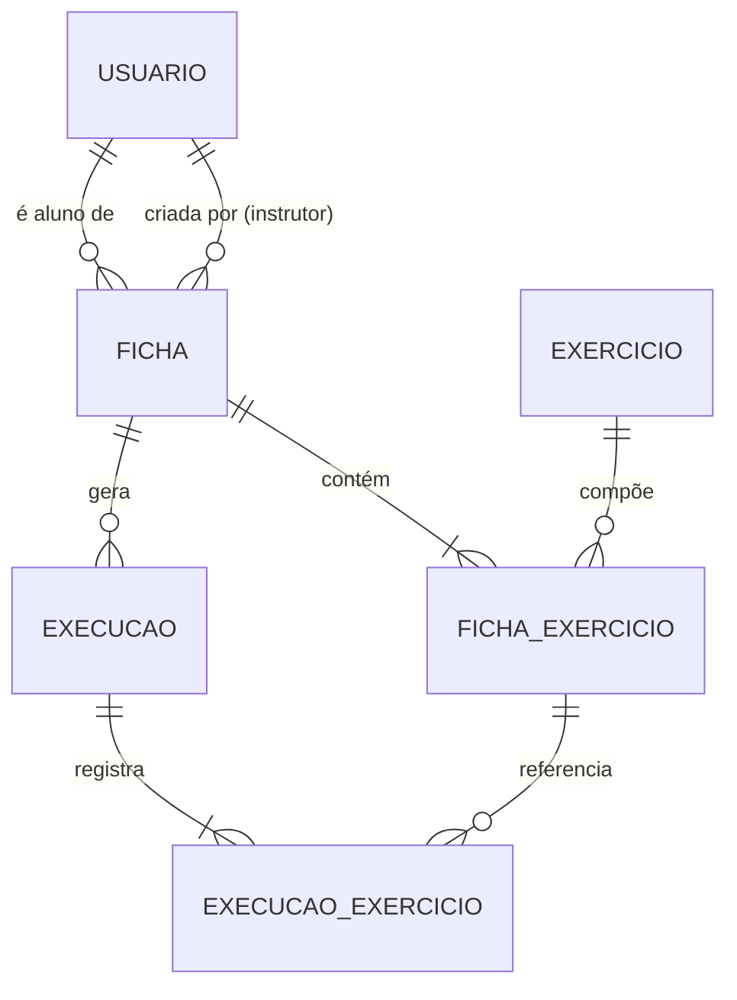

# Documento de Requisitos (ERS) — GymManager

**Sistema web de gerenciamento de treinos de academia**
Disciplina: Gerência de Configuração (6º período) · CENTRO UNIVERSITÁRIO FAMETRO
Professor: Paulo Rodrigo Barbosa Alves

| Campo | Valor |
| --- | --- |
| ID do IC | GYM-REQ-001 |
| Caminho | `documentos/requisitos/ERS.md` |
| Versão | 0.1.1 |
| Status | Em elaboração |
| Baseline prevista | BL-REQ-S1 (Funcional) |
| Responsável | Renata Martins da Silva (Analista de Requisitos) |
| Apoio | Todos |
| Dependência | GYM-GER-001 (Plano de Projeto) |
| ICs relacionados | GYM-REQ-002 (Casos de Uso), GYM-REQ-003 (RTM), GYM-REQ-004 (Protótipos de tela) |

## Histórico de revisões

| Versão | Data | Autor | Descrição | CR/Issue |
| --- | --- | --- | --- | --- |
| 0.1.0 | 09-11-2026 | Renata Martins da Silva | Versão inicial do documento | — |
| 0.1.1 | 09-11-2026 | Renata Martins da Silva|
| 0.1.2 | 10-11-2026| Renata Martins da Silva|

---

## 1. Introdução

### 1.1 Propósito

Este documento especifica os requisitos do **GymManager**, sistema web para gerenciamento de treinos de academia. Ele é a base para a arquitetura, a implementação, os testes e a rastreabilidade do projeto, e é o artefato central da baseline **BL-REQ-S1**, que será revisada pelo QA/Testes e aprovada pelo CCB (Plano de GC, seção 5).

Destina-se à equipe do projeto (Gerente de Projeto/Configuração, Analista de Requisitos, Dev Backend e Frontend, DBA/DevOps e QA/Testes) e ao professor avaliador.

### 1.2 Escopo

O GymManager centraliza o cadastro de alunos, o catálogo de exercícios, a montagem de fichas de treino e o registro dos treinos realizados, substituindo o controle em papel ou em planilhas soltas, que causa perda de histórico, fichas desatualizadas e pouca visibilidade da evolução do aluno.

**Dentro do escopo (versão 1.0.0):**

- Autenticação e perfis de acesso (administrador, instrutor, aluno).
- Cadastro de instrutores e usuários.
- Gestão de alunos, exercícios e fichas de treino.
- Registro e histórico de execução de treinos, com acompanhamento da evolução de carga.
- API REST documentada (OpenAPI) e interface web.
- Testes automatizados e pipeline de integração contínua.

**Fora do escopo:** aplicativo móvel nativo, pagamentos e mensalidades, integração com catracas ou wearables.

### 1.3 Visão geral do documento

A seção 2 apresenta a descrição geral do produto; a seção 3, os requisitos específicos (funcionais, não funcionais e regras de negócio); a seção 4, a modelagem (casos de uso, dados, interface e API); a seção 5, a rastreabilidade entre requisitos e Itens de Configuração (ICs); a seção 6, o controle de configuração deste documento.

### 1.4 Definições, acrônimos e abreviações

| Termo | Definição |
| --- | --- |
| ERS | Documento de Especificação de Requisitos |
| RF / RNF / RN | Requisito Funcional / Requisito Não Funcional / Regra de Negócio |
| UC | Caso de Uso |
| IC | Item de Configuração: artefato sob controle de versão e de mudanças |
| Baseline | Conjunto de ICs revisados e aprovados, congelado em um marco; só muda via CR |
| CR / CRF | *Change Request* / *Change Request Form* |
| CCB | *Change Control Board*: comitê que decide sobre as CRs |
| RTM | Matriz de Rastreabilidade de Requisitos |
| API REST | Interface de programação baseada em HTTP e recursos |
| Ficha de treino | Conjunto de exercícios com séries, repetições, carga e descanso, atribuído a um aluno |
| Execução de treino | Registro de uma sessão em que o aluno realizou a ficha |

### 1.5 Referências

- Plano de Projeto (GYM-GER-001).
- Planilha de Controle de ICs (GYM-GER-002).
- Plano de Gerência de Configuração (GYM-GER-003).
- README do repositório (GYM-DOC-001).
- IEEE Std 830-1998 e IEEE Std 29148-2018 (especificação de requisitos).
- SOMMERVILLE, I. *Engenharia de Software*. 10. ed. Pearson, 2019.
- PRESSMAN, R. S.; MAXIM, B. R. *Engenharia de Software: Uma Abordagem Profissional*. 9. ed. AMGH, 2021.

---

## 2. Descrição geral

### 2.1 Perspectiva do produto

Aplicação web cliente-servidor em camadas. O navegador consome uma API REST em Python/Flask, que persiste os dados em MySQL. O ambiente é reproduzível com Docker e docker-compose, e a verificação automática é feita por pipeline de CI no GitHub Actions.

```
[ Navegador: HTML/CSS/JavaScript ] --HTTP/JSON--> [ API REST: Flask ] --SQL--> [ MySQL ]
```

### 2.2 Tecnologias

Conforme a seção 4 do Plano de Projeto e o ADR da stack (GYM-ARQ-004).

| Camada | Tecnologia |
| --- | --- |
| Frontend | HTML, CSS, JavaScript |
| Backend | Python com Flask (API REST) |
| Banco de dados | MySQL, com migrações versionadas em `banco-de-dados/migracoes/` |
| Testes | pytest, Postman/Newman |
| CI/CD | GitHub Actions |
| Contêineres | Docker e docker-compose |
| Versionamento | Git + GitHub |

### 2.3 Funções do produto (visão resumida)

1. Autenticar usuários e controlar o acesso por perfil.
2. Cadastrar e manter instrutores, usuários e alunos.
3. Manter o catálogo de exercícios.
4. Montar fichas de treino e atribuí-las a alunos.
5. Registrar a execução dos treinos.
6. Consultar o histórico e a evolução de carga.

### 2.4 Usuários e perfis

| Perfil | Descrição | Principais funções |
| --- | --- | --- |
| Administrador | Responsável pela gestão do sistema | Gerencia usuários e instrutores; possui as permissões do instrutor |
| Instrutor | Profissional da academia | Gerencia alunos, exercícios e fichas; acompanha a evolução |
| Aluno | Praticante atendido pela academia | Consulta suas fichas, registra execuções e vê seu histórico |

### 2.5 Restrições

- O sistema é exclusivamente web (aplicativo móvel nativo fora do escopo).
- Devem ser usadas as tecnologias da seção 2.2.
- As entregas são semanais, às quartas-feiras, conforme o Plano de Projeto.
- Alterações neste documento após a baseline BL-REQ-S1 exigem CR aprovada pelo CCB.
- Segredos nunca são versionados; a configuração de ambiente usa `.env.example` sem valores reais.

### 2.6 Suposições e dependências

- Os usuários dispõem de navegador atualizado e acesso à rede da academia ou à internet.
- O primeiro usuário administrador é criado na implantação (migração ou script de carga inicial).
- O cadastro de alunos é feito por administrador ou instrutor; não há autocadastro.
- O ambiente de execução disponibiliza Docker e MySQL.

---

## 3. Requisitos específicos

### 3.1 Requisitos funcionais

| ID | Requisito | Perfil | Prioridade |
| --- | --- | --- | --- |
| RF01 | O sistema deve permitir **cadastrar, consultar, editar e inativar alunos**. | Admin, Instrutor | Alta |
| RF02 | O sistema deve **autenticar** usuários por e-mail e senha e **controlar o acesso por perfil** (administrador, instrutor, aluno). | Todos | Alta |
| RF03 | O sistema deve manter o **catálogo de exercícios** (cadastrar, consultar, editar e inativar), com nome, grupo muscular e descrição. | Admin, Instrutor | Alta |
| RF04 | O sistema deve permitir **montar fichas de treino**, com exercício, séries, repetições, carga e descanso, e atribuí-las a um aluno. | Admin, Instrutor | Alta |
| RF05 | O sistema deve permitir ao aluno **registrar a execução** de cada treino e consultar o **histórico e a evolução de carga**. | Aluno, Instrutor | Alta |
| RF06 | O sistema deve permitir **cadastrar e gerenciar instrutores e demais usuários**, definindo o perfil de cada um. | Admin | Alta |
| RF07 | O sistema deve oferecer uma **interface web** que consuma a API e exiba apenas as funções permitidas ao perfil logado. | Todos | Média |

**Critérios de aceite (resumo):**

| ID | Critério de aceite |
| --- | --- |
| RF01 | Aluno cadastrado aparece na listagem; aluno inativado não autentica e não recebe novas fichas. |
| RF02 | Credenciais válidas geram sessão; inválidas retornam erro; rota restrita retorna 403 a perfil não autorizado. |
| RF03 | Exercício cadastrado fica disponível para montagem de fichas; nome duplicado é rejeitado. |
| RF04 | Ficha salva com ao menos um exercício e atribuída a um aluno é exibida a ele. |
| RF05 | Execução registrada aparece no histórico; a evolução de carga é exibida por exercício. |
| RF06 | Instrutor cadastrado consegue autenticar-se com o perfil correto. |
| RF07 | Cada perfil vê apenas o menu e as telas permitidos; mensagens de erro e sucesso são exibidas. |

### 3.2 Requisitos não funcionais

| ID | Categoria | Requisito |
| --- | --- | --- |
| RNF01 | Segurança | Senhas armazenadas com hash seguro; nunca em texto puro. |
| RNF02 | Segurança | Todas as rotas, exceto o login, exigem autenticação; a autorização é verificada por perfil no backend. |
| RNF03 | Segurança | Nenhum segredo (senhas, chaves, tokens) é versionado; configuração via variáveis de ambiente (`.env.example`). |
| RNF04 | Desempenho | Respostas da API em até 2 s para 95% das requisições em condições normais de uso. |
| RNF05 | Usabilidade | Interface responsiva, utilizável em desktop e celular, com mensagens de erro claras. |
| RNF06 | Compatibilidade | Funcionamento nos principais navegadores atuais. |
| RNF07 | Manutenibilidade | Código em camadas, versionado no GitHub, com commits no padrão Conventional Commits e vinculados a issue/CR. |
| RNF08 | Qualidade | Testes unitários e de integração (pytest) e coleção Postman/Newman executados a cada Pull Request pelo CI. |
| RNF09 | Documentação | API especificada em OpenAPI (`openapi.yaml`), mantida coerente com o ERS. |
| RNF10 | Portabilidade | Ambiente reproduzível com Docker e docker-compose, a partir do `.env.example`. |
| RNF11 | Confiabilidade | Evolução do esquema do banco por migrações versionadas, sem alterações manuais. |
| RNF12 | Rastreabilidade | Cada requisito deve estar vinculado a ICs de projeto, código e teste na RTM (GYM-REQ-003). |

### 3.3 Regras de negócio

| ID | Regra | Relacionada a |
| --- | --- | --- |
| RN01 | Apenas administrador ou instrutor cria e atribui fichas de treino. | RF04 |
| RN02 | O aluno acessa somente suas próprias fichas, execuções e histórico. | RF04, RF05 |
| RN03 | Apenas o administrador cadastra instrutores e define perfis. | RF06 |
| RN04 | Exercício vinculado a uma ficha não é excluído; apenas inativado. | RF03 |
| RN05 | Usuário ou aluno inativo não se autentica e não recebe novas fichas; o histórico é preservado. | RF01, RF02, RF04, RF06 |
| RN06 | Uma ficha possui pelo menos um exercício e pertence a um único aluno. | RF04 |
| RN07 | A execução de treino refere-se a uma ficha atribuída ao próprio aluno. | RF05 |

---

## 4. Modelagem

### 4.1 Casos de uso

A modelagem de casos de uso é um documento próprio: `documentos/requisitos/Casos_de_Uso.md` (GYM-REQ-002). Nele estão o diagrama, a descrição de atores e o detalhamento de cada caso de uso (fluxos principal, alternativos e exceções). Esta seção traz apenas o mapa de casos de uso e sua relação com os requisitos.

**Atores:** Administrador, Instrutor e Aluno. O administrador possui as permissões do instrutor.

| ID | Caso de uso | Ator(es) | Requisito(s) |
| --- | --- | --- | --- |
| UC01 | Autenticar-se | Todos | RF02, RF07 |
| UC02 | Gerenciar usuários e instrutores | Administrador | RF06 |
| UC03 | Gerenciar alunos | Administrador, Instrutor | RF01 |
| UC04 | Gerenciar exercícios | Administrador, Instrutor | RF03 |
| UC05 | Montar e atribuir ficha de treino | Instrutor e Administrador | RF04 |
| UC06 | Consultar minhas fichas | Aluno | RF04, RF07 |
| UC07 | Registrar execução do treino | Aluno | RF05 |
| UC08 | Consultar histórico e evolução de carga | Aluno, Instrutor, Administrador | RF05 |

### 4.2 Modelo de dados conceitual

O modelo entidade-relacionamento e o dicionário de dados completos ficam em `documentos/arquitetura/Modelo_de_Dados.md` (GYM-ARQ-002), e a criação do esquema, em `banco-de-dados/migracoes/` (GYM-DB-001). Abaixo, a visão conceitual que sustenta os requisitos.



| Entidade | Atributos principais |
| --- | --- |
| USUARIO | id, nome, e-mail (único), senha (hash), perfil (ADMIN, INSTRUTOR, ALUNO), ativo, dados do aluno (data de nascimento, telefone) |
| EXERCICIO | id, nome (único), grupo muscular, descrição, ativo |
| FICHA | id, nome, aluno, instrutor, data de início, data de fim, ativa |
| FICHA_EXERCICIO | id, ficha, exercício, séries, repetições, carga (kg), descanso (s), ordem |
| EXECUCAO | id, ficha, aluno, data/hora de início, data/hora de fim |
| EXECUCAO_EXERCICIO | id, execução, item da ficha, repetições realizadas, carga realizada (kg) |

### 4.3 Regras de validação

| Campo | Regra | Mensagem de erro |
| --- | --- | --- |
| e-mail | Formato válido e único | "E-mail inválido ou já cadastrado." |
| senha | Mínimo de 8 caracteres, com letras e números | "Senha fraca." |
| nome | Obrigatório, de 2 a 100 caracteres | "Nome obrigatório." |
| perfil | Um de ADMIN, INSTRUTOR ou ALUNO | "Perfil inválido." |
| exercício (nome) | Obrigatório e único | "Exercício já cadastrado." |
| séries, repetições | Inteiros maiores que zero | "Valor deve ser maior que zero." |
| carga (kg) | Número maior ou igual a zero, até 2 casas decimais | "Carga inválida." |
| descanso (s) | Inteiro maior ou igual a zero | "Descanso inválido." |
| data de fim | Maior ou igual à data de início | "Data final anterior à inicial." |

As validações são aplicadas no backend; o frontend as replica para melhorar a usabilidade.

### 4.4 Requisitos de interface

Os protótipos estão em `prototipos/` (`telas-login.png`, `telas-cadastro.png`, `outras-telas.png`), mantidos em GYM-REQ-004.

| ID | Tela | Perfil | Requisito(s) |
| --- | --- | --- | --- |
| TL01 | Login | Todos | RF02, RF07 |
| TL02 | Painel inicial | Todos | RF07 |
| TL03 | Usuários e instrutores | Administrador | RF06 |
| TL04 | Alunos (lista e cadastro) | Administrador, Instrutor | RF01 |
| TL05 | Catálogo de exercícios | Administrador, Instrutor | RF03 |
| TL06 | Montagem de ficha de treino | Instrutor | RF04 |
| TL07 | Minhas fichas | Aluno | RF04, RF07 |
| TL08 | Registro de execução | Aluno | RF05 |
| TL09 | Histórico e evolução de carga | Aluno, Instrutor | RF05 |

**Diretrizes:** layout responsivo; menu conforme o perfil; mensagens de erro e sucesso claras; confirmação antes de ações destrutivas (inativar).

### 4.5 Requisitos da API REST

O contrato completo será mantido em `documentos/arquitetura/openapi.yaml` (GYM-ARQ-003). Base: `/api/v1`; formato: JSON; autenticação obrigatória, exceto no login.

| Método | Endpoint | Descrição | Perfil | RF |
| --- | --- | --- | --- | --- |
| POST | `/auth/login` | Autentica e retorna credencial de acesso | Público | RF02 |
| POST | `/auth/logout` | Encerra a sessão | Todos | RF02 |
| GET | `/usuarios` | Lista usuários | Admin | RF06 |
| POST | `/usuarios` | Cadastra usuário ou instrutor | Admin | RF06 |
| PUT | `/usuarios/{id}` | Atualiza usuário | Admin | RF06 |
| DELETE | `/usuarios/{id}` | Inativa usuário | Admin | RF06 |
| GET | `/alunos` | Lista alunos | Admin, Instrutor | RF01 |
| POST | `/alunos` | Cadastra aluno | Admin, Instrutor | RF01 |
| GET | `/alunos/{id}` | Consulta aluno | Admin, Instrutor | RF01 |
| PUT | `/alunos/{id}` | Atualiza aluno | Admin, Instrutor | RF01 |
| DELETE | `/alunos/{id}` | Inativa aluno | Admin, Instrutor | RF01 |
| GET | `/exercicios` | Lista exercícios | Todos | RF03 |
| POST | `/exercicios` | Cadastra exercício | Admin, Instrutor | RF03 |
| PUT | `/exercicios/{id}` | Atualiza exercício | Admin, Instrutor | RF03 |
| DELETE | `/exercicios/{id}` | Inativa exercício | Admin, Instrutor | RF03 |
| GET | `/fichas` | Lista fichas (do aluno logado ou filtradas) | Todos | RF04 |
| POST | `/fichas` | Cria ficha e atribui a aluno | Admin, Instrutor | RF04 |
| GET | `/fichas/{id}` | Detalha ficha | Todos | RF04 |
| PUT | `/fichas/{id}` | Atualiza ficha | Admin, Instrutor | RF04 |
| POST | `/execucoes` | Inicia execução de uma ficha | Aluno | RF05 |
| POST | `/execucoes/{id}/exercicios` | Registra repetições e carga de um exercício | Aluno | RF05 |
| PATCH | `/execucoes/{id}/finalizar` | Finaliza a execução | Aluno | RF05 |
| GET | `/alunos/{id}/historico` | Histórico e evolução de carga | Aluno (próprio), Admin, Instrutor | RF05 |

**Códigos de resposta:** `200` sucesso; `201` criado; `400` dados inválidos; `401` não autenticado; `403` sem permissão; `404` não encontrado; `409` conflito; `500` erro interno.

---

## 5. Rastreabilidade (visão inicial da RTM)

Cada requisito está vinculado a um IC de projeto, a um IC de código e a um IC de teste, conforme exigido. A matriz completa é mantida em `documentos/requisitos/RTM.xlsx` (GYM-REQ-003).

| Requisito | Casos de uso | Telas | IC de projeto | IC de código | IC de teste |
| --- | --- | --- | --- | --- | --- |
| RF01 | UC03 | TL04 | GYM-REQ-001, GYM-ARQ-003, GYM-ARQ-002 | GYM-SRC-002, GYM-SRC-006 | GYM-TST-001, GYM-TST-002, GYM-TST-003, GYM-TST-004 |
| RF02 | UC01 | TL01 | GYM-REQ-001, GYM-ARQ-001, GYM-ARQ-003 | GYM-SRC-001, GYM-SRC-006 | GYM-TST-001, GYM-TST-002, GYM-TST-003, GYM-TST-004 |
| RF03 | UC04 | TL05 | GYM-REQ-001, GYM-ARQ-003, GYM-ARQ-002 | GYM-SRC-003, GYM-SRC-006 | GYM-TST-001, GYM-TST-002, GYM-TST-003, GYM-TST-004 |
| RF04 | UC05, UC06 | TL06, TL07 | GYM-REQ-001, GYM-ARQ-003, GYM-ARQ-002 | GYM-SRC-004, GYM-SRC-006 | GYM-TST-001, GYM-TST-002, GYM-TST-003, GYM-TST-004 |
| RF05 | UC07, UC08 | TL08, TL09 | GYM-REQ-001, GYM-ARQ-003, GYM-ARQ-002 | GYM-SRC-005, GYM-SRC-006 | GYM-TST-001, GYM-TST-002, GYM-TST-003, GYM-TST-004 |
| RF06 | UC02 | TL03 | GYM-REQ-001, GYM-ARQ-003, GYM-ARQ-002 | GYM-SRC-001, GYM-SRC-006 | GYM-TST-001, GYM-TST-002, GYM-TST-003, GYM-TST-004 |
| RF07 | UC01 a UC08 | TL01 a TL09 | GYM-REQ-004, GYM-ARQ-003 | GYM-SRC-006 | GYM-TST-001, GYM-TST-004 |

| Requisito não funcional | IC de projeto | IC de código / configuração | IC de teste |
| --- | --- | --- | --- |
| RNF01, RNF02 | GYM-ARQ-001 | GYM-SRC-001 | GYM-TST-002, GYM-TST-003 |
| RNF03 | GYM-GER-003 | GYM-CFG-001, GYM-CFG-002 | GYM-CI-001 |
| RNF04, RNF05, RNF06 | GYM-ARQ-001 | GYM-SRC-006 | GYM-TST-001 |
| RNF07 | GYM-GER-003, GYM-GER-004 | GYM-CFG-001 | GYM-CI-001 |
| RNF08 | GYM-TST-001 | GYM-CI-001 | GYM-TST-002, GYM-TST-003, GYM-TST-004 |
| RNF09 | GYM-ARQ-003 | GYM-SRC-001 a GYM-SRC-005 | GYM-TST-004 |
| RNF10 | GYM-ARQ-004 | GYM-IAC-001, GYM-CFG-002 | GYM-CI-001 |
| RNF11 | GYM-ARQ-002 | GYM-DB-001 | GYM-TST-003 |
| RNF12 | GYM-REQ-003 | GYM-GER-002 | GYM-GER-003 |

---

## 6. Controle de configuração deste documento

- Este ERS é o IC **GYM-REQ-001** e está sujeito às regras do Plano de GC (GYM-GER-003).
- Até a baseline BL-REQ-S1, alterações seguem por issue e Pull Request, revisadas por outro integrante; após a baseline, somente mediante CR aprovada pelo CCB (Gerente de Projeto/Configuração, Analista de Requisitos e Dev Backend e Frontend).
- Toda mudança de requisito deve atualizar, no mesmo PR ou CR, os ICs dependentes: Casos de Uso (GYM-REQ-002), RTM (GYM-REQ-003), protótipos (GYM-REQ-004) e Plano de Testes (GYM-TST-001).
- Cada revisão incrementa a versão (SemVer) no início do documento, no histórico de revisões e na planilha de ICs (GYM-GER-002).
- Antes de entrar em baseline, o ERS passa por revisão técnica formal do QA/Testes (Iago Medice Ferreira da Silva, Tiago Costa dos Santos e Ruan Victor Assunção Costa) e por auditoria de configuração.

### Lista de verificação para a baseline BL-REQ-S1

| # | Verificação | Resultado |
| --- | --- | --- |
| 1 | ID, caminho, versão e responsável do ERS coincidem com a planilha de ICs | ☐ |
| 2 | Todos os RF e RNF possuem IC de projeto, código e teste na RTM | ☐ |
| 3 | Casos de Uso e protótipos coerentes com os requisitos | ☐ |
| 4 | Tecnologias coerentes com o Plano de Projeto e o ADR da stack | ☐ |
| 5 | Revisão técnica do QA/Testes registrada | ☐ |
| 6 | Aprovação do CCB registrada | ☐ |
